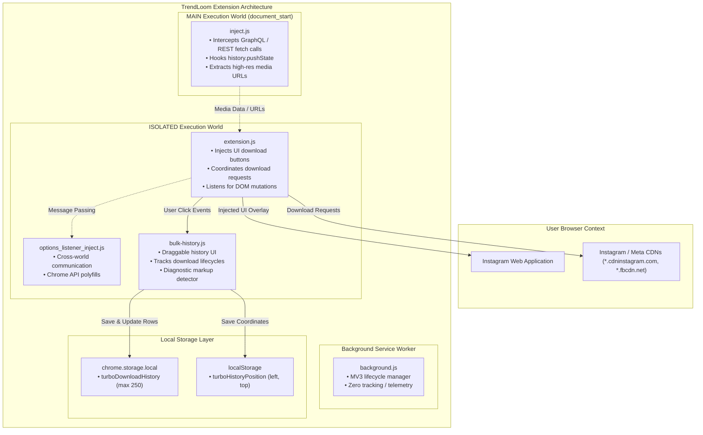

# TrendLoom Instagram Downloader

[](package.json)
[](manifest.json)
[](LICENSE.md)
[](package.json)
[](src/tests/)
[](.prettierrc.json)
[](PRIVACY.md)

<div align="center">
  <h3>Private, fast, and polished Instagram media downloads for Chrome and Chromium browsers.</h3>
  <p>Download photos, videos, carousel posts, Stories, Highlights, Reels, and profile avatars without sending your data anywhere.</p>
</div>

<p align="center">
  <a href="#installation"><strong>Install</strong></a> ·
  <a href="#how-to-use"><strong>How it works</strong></a> ·
  <a href="#privacy-and-security"><strong>Privacy</strong></a> ·
  <a href="#contributing"><strong>Contribute</strong></a>
</p>

> [!TIP]
> TrendLoom is built for personal use, runs entirely on your device, and keeps a local-only history of recent downloads.

---

## Table of Contents

- [Features](#features)
- [Installation](#installation)
  - [Prerequisites](#prerequisites)
  - [Building from Source](#building-from-source)
  - [Loading into Chrome or Edge](#loading-into-chrome-or-edge)
  - [Chrome Web Store](#chrome-web-store)
- [How to Use](#how-to-use)
  - [Single Photos and Videos](#single-photos-and-videos)
  - [Carousel Posts (Download Single or All)](#carousel-posts-download-single-or-all)
  - [Instagram Reels](#instagram-reels)
  - [Stories and Highlights](#stories-and-highlights)
  - [Profile Avatars](#profile-avatars)
  - [Draggable Floating History Panel](#draggable-floating-history-panel)
  - [Keyboard Shortcuts and Accessibility](#keyboard-shortcuts-and-accessibility)
- [Architecture and Technical Design](#architecture-and-technical-design)
  - [Multi-World Content Script Execution](#multi-world-content-script-execution)
  - [Background Service Worker (Manifest V3)](#background-service-worker-manifest-v3)
  - [Storage Model and Quotas](#storage-model-and-quotas)
  - [Data Flow Diagram](#data-flow-diagram)
- [Project Structure](#project-structure)
- [Available Scripts](#available-scripts)
- [Development and Tooling](#development-and-tooling)
  - [Development Workflow](#development-workflow)
  - [Auto-Reload with chrome-cli](#auto-reload-with-chrome-cli)
  - [Code Quality and Formatting](#code-quality-and-formatting)
  - [Running Tests](#running-tests)
  - [Type Checking](#type-checking)
- [Configuration and Options](#configuration-and-options)
- [Privacy and Security](#privacy-and-security)
  - [Permissions](#permissions)
  - [Content Security Policy (CSP)](#content-security-policy-csp)
  - [Zero Telemetry Guarantee](#zero-telemetry-guarantee)
- [Troubleshooting](#troubleshooting)
- [Contributing](#contributing)
- [Changelog](#changelog)
- [Developer and Contacts](#developer-and-contacts)
- [License and Credits](#license-and-credits)
- [Disclaimer](#disclaimer)

---

## Features

<div align="left">
  <table>
    <tr>
      <td width="33%">
        <strong>📸 Complete media coverage</strong><br>
        Download photos, video clips, carousels, Stories, Highlights, Reels, and profile avatars.
      </td>
      <td width="33%">
        <strong>🧩 Smart history panel</strong><br>
        Persistent, draggable floating history with status tracking and one-click clearing.
      </td>
      <td width="33%">
        <strong>🔒 Privacy-first design</strong><br>
        Works locally in-browser with no telemetry, no analytics, and no external tracking servers.
      </td>
    </tr>
    <tr>
      <td width="33%">
        <strong>⌨️ Accessibility-first UX</strong><br>
        Keyboard support, reduced-motion handling, and semantic ARIA labeling throughout the UI.
      </td>
      <td width="33%">
        <strong>⚙️ Chromium-ready</strong><br>
        Built for Chrome, Edge, Brave, Opera, and other Manifest V3-compatible browsers.
      </td>
      <td width="33%">
        <strong>🛠️ Modern tooling</strong><br>
        Webpack, Babel, Prettier, ESLint, Jest, and TypeScript definitions included for smooth development.
      </td>
    </tr>
  </table>
</div>

- **Comprehensive Media Downloads**:
  - **Photos & Videos**: Download single image posts and video clips in their highest available resolution.
  - **Carousel Posts**: Download individual carousel slides or batch-download all items simultaneously with a single click.
  - **Reels**: Integrated download button directly in the Instagram Reels feed, with a separate thumbnail control when a poster is available.
  - **Stories & Highlights**: Save single Stories or all active Stories/Highlights from an account.
  - **Profile Pictures**: Hover over profile avatars to download high-resolution account pictures.
- **Draggable Download History Panel**:
  - Status tracking (`downloading`, `completed`, or `failed`) follows the progress element created for each download. Missing progress is reported as a failure rather than a success.
  - `completed` means the media request finished and the browser download was triggered; the extension does not inspect the browser's download shelf.
  - Keeps the 250 most recent download entries locally in `chrome.storage.local`.
  - Floating action button that snaps to nearby screen edges, stays in view after resizing, and remembers its position (`localStorage`).
  - Diagnostic warnings if Instagram markup changes (`No download buttons found`).
  - One-click "Clear history" button.
- **Accessibility First**:
  - Semantic ARIA attributes (`role="region"`, `aria-expanded`, `aria-controls`, `aria-label`).
  - Full keyboard navigability (`Tab`, `Shift+Tab`, `Enter`, `Space`).
  - High-contrast focus rings and support for `prefers-reduced-motion`.
- **Privacy & Security**:
  - 100% local operation: zero telemetry, zero analytics, no external tracking servers.
  - Media downloads connect directly between your browser and Instagram/Meta CDNs (`*.cdninstagram.com`, `*.fbcdn.net`).
  - Strict Manifest V3 Content Security Policy (CSP).
  - Minimal permissions model (only `storage` and necessary host permissions).
- **Modern Build Infrastructure**:
  - Webpack 5 production build with Babel, TypeScript definitions, SASS/CSS extraction, and minification.
  - ESLint and Prettier configured for code consistency.
  - Comprehensive Jest unit test suite with JSDOM and Chrome API mocks.

---

## Installation

### Prerequisites

- **Node.js**: `>= 18.0.0`
- **npm**: `>= 9.0.0`
- Any Chromium-based browser (Google Chrome, Microsoft Edge, Brave, Opera, Vivaldi) supporting **Manifest V3**.

### Building from Source

1. Clone or download the repository to your local machine:
   ```bash
   git clone https://github.com/TrendLoom/trendloom-instagram-downloader.git
   cd trendloom-instagram-downloader
   ```

2. Install dependencies:
   ```bash
   npm install
   ```

3. Build the extension for production:
   ```bash
   npm run build
   ```
   This compiles and bundles all source files into the `dist/` directory.

### Loading into Chrome or Edge

1. Open your browser and navigate to the extensions page:
   - **Google Chrome**: `chrome://extensions/`
   - **Microsoft Edge**: `edge://extensions/`
   - **Brave**: `brave://extensions/`
2. Enable the **Developer mode** toggle in the top-right corner.
3. Click the **Load unpacked** button.
4. Select the `dist/` directory inside this project folder.
5. The extension is now loaded and active! Navigate to [Instagram](https://www.instagram.com) to begin using it.

### Chrome Web Store

A pre-packaged ZIP bundle can be generated at `dist/trendloom-instagram-downloader.zip` for Web Store submission:
```bash
npm run zip
```

---

## How to Use

Once installed, TrendLoom seamlessly integrates download triggers into Instagram's web interface.

### Single Photos and Videos
- Hover over any post on your feed or explore grid to see the download button overlay.
- On single post pages, click the download icon in the upper-right corner of the media item.

### Carousel Posts (Download Single or All)
- **Individual Slide**: Navigate to the desired image or video in the carousel and click the single download button.
- **All Slides**: Click the **Download All** icon (`.post-download-all-button`) above the carousel to download every photo and video in the post sequentially.

### Instagram Reels
- When watching Reels in the Reels feed, click the download button located in the right-hand interaction rail (`.reels-feed-download-button`).
- If a poster image is available, use the adjacent thumbnail control to save it separately. The extension displays a success or failure message.

### Stories and Highlights
- When viewing a Story or Highlight, download controls appear at the top:
  - **Single Story**: Download the active image or video slide (`.story-download-button`).
  - **All Stories**: Download all active stories from the user in sequence (`.story-download-all-button`).

### Profile Avatars
- Navigate to any user's profile page and hover over their avatar picture. Click the download overlay button (`.account-download-button`) to retrieve their high-resolution profile picture.

### Draggable Floating History Panel
- Look for the circular floating download history button in the bottom-right corner of the page.
- **Expand / Collapse**: Click the toggle button to open or close the panel.
- **Drag & Reposition**: Click and hold the toggle button to drag it anywhere on the screen. The coordinates are automatically saved to `localStorage` (`turboHistoryPosition`) and restored across page visits.
- **Keyboard Reposition**: Focus the button and press `Alt + Arrow` to move it; hold `Shift` for larger steps. Dragging snaps the button to nearby edges.
- **View Status**: Review each download's real-time state (`downloading`, `completed`, or `failed` with error details).
- **Clear History**: Click "Clear history" to reset the log.

### Keyboard Shortcuts and Accessibility
- `Tab` / `Shift + Tab`: Move focus through interactive elements including injected download buttons and history controls.
- `Enter` / `Space`: Trigger the focused download button or toggle the history panel.
- `Alt + Arrow keys`: Move the floating history button; `Shift + Alt + Arrow` moves it farther.
- ARIA landmarks and live status alerts inform screen readers of download operations.

---

## Architecture and Technical Design

The extension uses Chrome Manifest V3 with a multi-context script execution model designed for performance and stability.



### Multi-World Content Script Execution

1. **MAIN World (`inject.js`)**:
   - Executes at `document_start` within Instagram's page execution context.
   - Intercepts page fetch/XHR calls and GraphQL responses to extract raw, uncompressed media URLs.
   - Hooks into the browser History API (`pushState`, `replaceState`) to detect dynamic client-side route transitions without requiring full page reloads.

2. **ISOLATED World Bridge (`options_listener_inject.js`)**:
   - Executes at `document_start` in an isolated world context.
   - Polyfills browser extension APIs and passes configuration options between contexts safely.

3. **ISOLATED World UI & Logic (`extension.js` + `bulk-history.js`)**:
   - `extension.js`: Injects download buttons into feed posts, carousels, Reels, and profile avatars using DOM observers and styled by `src/css/extension.css`.
   - `bulk-history.js`: Listens globally for clicks on any TrendLoom download button, writes entries to `chrome.storage.local`, monitors download progress bars (`.downloadProgress`) and alert banners, and updates item statuses accordingly.

### Background Service Worker (Manifest V3)
- `src/js/background.js` serves as the Manifest V3 service worker entry point.
- Media streams are fetched and initiated directly by content scripts in the user's active session, meaning the service worker does not proxy traffic, transmit analytics, or consume background memory unnecessarily.

### Storage Model and Quotas
- **History List (`turboDownloadHistory`)**: Stored in `chrome.storage.local`. Managed through `src/js/utils/storage.js` with a hard limit of `250` items (`DOWNLOAD_HISTORY_LIMIT = 250`). Writes are serialized via a promise queue to prevent race conditions during rapid downloads.
- **Panel Position (`turboHistoryPosition`)**: Stored in `localStorage` as `{ left: string, top: string }`, allowing instant retrieval on page mount without asynchronous storage delay.

---

## Project Structure

```
trendloom-instagram-downloader/
├── .github/
│   └── workflows/
│       └── ci.yml               # GitHub Actions CI workflow (lint, typecheck, test, build)
├── dist/                        # Production build output (load as unpacked extension)
├── icons/                       # Extension icons and UI SVG graphics
│   ├── download_all_black.svg
│   ├── download_all_white.svg
│   ├── download_black.svg
│   ├── download_white.svg
│   ├── trendloom-16.png
│   ├── trendloom-32.png
│   ├── trendloom-48.png
│   ├── trendloom-logo-128.png
│   └── ...
├── scripts/
│   └── reload-extension.js      # Auto-reload extension watcher for local development
├── src/
│   ├── css/
│   │   ├── extension.css        # Content script styles (injected buttons & alerts)
│   │   └── options.css          # Extension options page styles
│   ├── js/
│   │   ├── utils/
│   │   │   ├── storage.js       # Centralized Chrome storage manager & history limit
│   │   │   └── instagram-compat.js # Instagram route, selector and media DOM adapter
│   │   ├── background.js        # Minimal Manifest V3 service worker
│   │   ├── bulk-history.js      # Draggable download history panel & event tracker
│   │   ├── extension.js         # Core UI button injector & download coordinator
│   │   ├── inject.js            # MAIN world API interceptor & GraphQL data extractor
│   │   ├── options.js           # Extension settings interface logic
│   │   └── options_listener_inject.js # Cross-world bridge & API polyfills
│   ├── tests/
│   │   ├── bulk-history.test.js # Unit tests for history panel & accessibility
│   │   ├── setup.js             # Jest test environment & Chrome API mocks
│   │   ├── storage.test.js      # Unit tests for storage utilities
│   │   └── instagram-compat.test.js # Route and Instagram markup adapter tests
│   └── types/
│       └── index.d.ts           # TypeScript definitions for Chrome APIs and data structures
├── .babelrc                     # Babel transpiler configuration
├── .eslintrc.json               # ESLint code quality configuration
├── .gitignore                   # Git ignore patterns
├── .prettierrc.json             # Prettier code formatting rules
├── CHANGELOG.md                 # Semantic versioning release history
├── IMPROVEMENTS.md              # Technical refactoring and improvements log
├── jest.config.js               # Jest test runner configuration
├── LICENSE.md                   # MIT License and upstream attribution
├── manifest.json                # Manifest V3 extension configuration
├── options.html                 # Extension settings page template
├── package.json                 # Project dependencies and script definitions
├── PRIVACY.md                   # Privacy disclosure and data handling policies
├── README.md                    # Project documentation (this file)
├── tsconfig.json                # TypeScript compiler options
└── webpack.config.js            # Webpack bundling configuration
```

> **Note**: `src/js/extension.js`, `src/js/inject.js`, `src/js/options.js`, and `src/js/options_listener_inject.js` are prebuilt upstream bundles. They are compiled into `dist/` by Webpack and intentionally excluded from linting and formatting. Keep Instagram route, selector, and DOM compatibility logic in the hand-written `src/js/utils/instagram-compat.js` adapter so bundle updates do not overwrite it. Hand-written sources subject to linting and formatting are `src/js/background.js`, `src/js/bulk-history.js`, `src/js/utils/*.js`, and `src/tests/*.js`.

---

## Available Scripts

| Script | Command | Description |
|---|---|---|
| `npm run dev` | `webpack --mode development --watch` | Builds extension in development mode and watches for file changes. |
| `npm run dev:reload` | `npm run dev & node scripts/reload-extension.js` | Watches for changes and auto-reloads the extension in Chrome (requires `chrome-cli`). |
| `npm run build` | `webpack --mode production` | Compiles production bundle with minification to `dist/`. |
| `npm run build:dev` | `webpack --mode development` | Compiles development bundle with source maps to `dist/`. |
| `npm run lint` | `eslint ...` | Lints hand-written JavaScript files. |
| `npm run lint:fix` | `eslint ... --fix` | Automatically fixes ESLint errors and code formatting. |
| `npm run format` | `prettier --write ...` | Formats hand-written source code using Prettier. |
| `npm run format:check` | `prettier --check ...` | Checks that code adheres to Prettier formatting rules. |
| `npm run test` | `jest` | Executes unit test suites with Jest and JSDOM. |
| `npm run test:watch` | `jest --watch` | Runs Jest in interactive watch mode. |
| `npm run typecheck` | `tsc --noEmit` | Validates TypeScript definitions against `tsconfig.json`. |
| `npm run clean` | `rm -rf dist node_modules` | Removes build output and dependencies. |
| `npm run zip` | `npm run build && ...` | Creates a distributable ZIP package at `dist/trendloom-instagram-downloader.zip`. |

---

## Development and Tooling

### Development Workflow

1. Install dependencies:
   ```bash
   npm install
   ```
2. Start Webpack in watch mode:
   ```bash
   npm run dev
   ```
3. Load the `dist/` folder into your browser as an unpacked extension.
4. Modify files in `src/` or `icons/` — Webpack will automatically recompile.
5. Reload the extension in your browser's extensions page to see changes.

### Auto-Reload with chrome-cli

To enable automatic extension reloading on file save without manual clicking:
1. Install `chrome-cli`:
   ```bash
   brew install chrome-cli
   ```
2. Set your extension ID and start the watcher:
   ```bash
   EXTENSION_ID="your_extension_id_here" npm run dev:reload
   ```

### Code Quality and Formatting

The project enforces code quality standards using ESLint and Prettier:
```bash
# Check code for lint issues
npm run lint

# Auto-fix lint and formatting issues
npm run lint:fix
npm run format
```

### Running Tests

Unit tests are written with [Jest](https://jestjs.io/) and run in a simulated browser environment with JSDOM and Chrome storage mocks:
```bash
# Run all tests once
npm run test

# Run tests in watch mode
npm run test:watch
```

Test files are located in `src/tests/`:
- `bulk-history.test.js`: Verifies history actions, progress outcomes, keyboard movement, thumbnail feedback, and mobile/accessibility styles.
- `instagram-compat.test.js`: Verifies Instagram route detection, supported download selectors, post details, and Reel poster lookup.
- `storage.test.js`: Tests storage getters, setters, removal, error handling, and the 250-item trimming limit.

For real Instagram, touch, and browser download checks, follow the [browser QA checklist](BROWSER_QA.md). Jest runs in JSDOM and does not replace those manual checks.

### Type Checking

Type definitions are defined in `src/types/index.d.ts` and configured in `tsconfig.json`. Validate types with:
```bash
npm run typecheck
```

---

## Configuration and Options

Access extension settings by:
- Right-clicking the extension icon in your browser toolbar and selecting **Options**.
- Navigating to `chrome://extensions/` → click **Details** on TrendLoom → click **Extension options**.

### Available Settings
- **Accounts download folder**: Specifies the subfolder in your Downloads directory where bulk/account downloads are placed.
- **Always show download icon in carousel**: Forces the download icon to remain visible on all carousel slides instead of only displaying on hover.
- **Experiments**: Opt-in to experimental features and optimizations.

### Storage Keys Reference
| Key | Storage | Description | Limit |
|---|---|---|---|
| `turboDownloadHistory` | `chrome.storage.local` | Array of download records (`id`, `label`, `url`, `status`, `error`, `createdAt`, `updatedAt`) | `250` items |
| `turboHistoryPosition` | `localStorage` | Screen coordinates `{ left, top }` for the floating history panel | 1 object |

---

## Privacy and Security

TrendLoom is built from the ground up to respect user privacy and security. Read [PRIVACY.md](PRIVACY.md) for the complete privacy policy.

### Permissions

The extension requests the absolute minimum permissions required to function:
- **`storage`**: Used solely to persist your user settings and recent download history locally on your device.
- **Host Permissions**:
  - `*://*.instagram.com/*`: Injects content scripts to render download buttons and detect media elements.
  - `*://*.cdninstagram.com/*`, `*://*.cdninstagram.net/*`, `*://*.fbcdn.net/*`: Allows your browser to fetch raw media files directly from Meta's Content Delivery Networks.

### Content Security Policy (CSP)

Configured with a strict Manifest V3 policy:
```json
"content_security_policy": {
  "extension_pages": "script-src 'self'; object-src 'self'"
}
```
- No remote code execution.
- No `eval()` or dynamic script loading.
- All code runs strictly from the local extension package.

### Zero Telemetry Guarantee
- **No analytics tracking**: Google Analytics, Mixpanel, and similar trackers are not used.
- **No external error logging**: Third-party error reporting (such as Sentry) is completely absent.
- **No credentials collected**: The extension never inspects, accesses, or transmits passwords, auth tokens, or cookies.

---

## Troubleshooting

### Download Buttons Do Not Appear
- **Instagram Markup Change**: Instagram frequently updates its web DOM structure. If download buttons stop appearing, open the download history panel to check for the diagnostic message:
  ```
  [TrendLoom] No download buttons found on this page...
  ```
  If this occurs, the selectors in `src/css/extension.css` and `src/js/extension.js` may need to be updated.
- **Page Not Fully Loaded**: Refresh the Instagram tab (`Cmd + R` or `Ctrl + R`).

### Download Times Out or Fails
- **Rate Limiting**: Downloading large batches of Stories or Carousel items in rapid succession may cause Instagram's CDN to temporarily throttle requests. Wait 1–2 minutes before trying again.
- **Private Content**: Ensure you are logged into an Instagram account that has permission to view the target post or story.

### Extension Fails to Load in Browser
- Ensure you have built the project before loading (`npm run build`).
- Verify that you selected the `dist/` folder when clicking **Load unpacked**, not the project root.
- Check the Extensions page for red error badges and review the console log.

---

## Contributing

Contributions, bug reports, and suggestions are welcome!

1. Fork the repository.
2. Create a feature branch:
   ```bash
   git checkout -b feature/my-new-feature
   ```
3. Make your changes in `src/`.
4. Ensure code passes all quality checks:
   ```bash
   npm run lint:fix
   npm run format
   npm run typecheck
   npm run test
   npm run build
   ```
5. Commit your changes:
   ```bash
   git commit -m "feat: add support for new feature"
   ```
6. Push to your branch and open a Pull Request.

---

## Changelog

See [CHANGELOG.md](CHANGELOG.md) for version history, changes, and migration details.

---

## Developer and Contacts

**TrendLoom Studio**  
- **Lead Developer & Maintainer**: Ajit Waghare
- **Email**: [trendloommedia@gmail.com](mailto:trendloommedia@gmail.com)
- **GitHub Repository**: [TrendLoom-Instagram-Downloader](https://github.com/TrendLoom/trendloom-instagram-downloader)
- **Issue Tracker**: [GitHub Issues](https://github.com/TrendLoom/trendloom-instagram-downloader/issues)
- **Support & Inquiries**: For commercial queries, custom feature requests, or general feedback, please reach out via email.

---

## License and Credits

- **License**: Released under the [MIT License](LICENSE.md). Copyright (c) 2024 TrendLoom.
- **Credits**: Based on InstagramDownloader by [HuiiBuh](https://github.com/HuiiBuh).

---

## Disclaimer

This browser extension is intended for personal use and archival purposes only. Please respect Instagram's Terms of Service and copyright laws when downloading media. The authors and contributors are not responsible for any misuse of this software.
